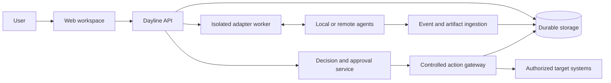

# Dayline Product Requirements

[中文版](PRD_CN.md)

- Version: 0.1
- Date: 2026-09-23
- Status: Product and technical discussion baseline. Requirements are not claims of implemented capabilities.
- Goal: Start with one person connecting their own agents, then grow into an everyday agent workspace for individuals and small teams.
- Naming: Dayline is a working name. Check name, trademark, and domain availability before launch.

## 1. Product Positioning

> Let agents move work forward while you understand progress, redirect the work, and decide before consequential actions happen.

Dayline is a work-supervision platform connecting people with different agents. It turns work scattered across chats, terminals, scripts, and services into trackable tasks, inspectable artifacts, and explicit decisions requiring attention.

It does not require switching models, rewriting every agent, or learning a workflow builder. People keep their existing executors and progressively connect the capabilities Dayline supports.

The core product is not chat, a daily update generator, or an approval button. It is the complete work cycle:

```text
Set a goal -> Bound the scope -> Agent executes -> Human inspects or intervenes
           -> Revise and review -> Authorize necessary actions -> Verify results -> Keep a record
```

The product serves people using and supervising agents. Agent frameworks, model evaluation platforms, and enterprise governance systems are adjacent categories, not the initial products to replace.

## 2. Problem

For someone using several agents, the problem is no longer just writing a good prompt:

1. They cannot easily tell where each task stands or which tasks are waiting on them.
2. Returning to work requires rereading long conversations to reconstruct context.
3. An agent says it finished, but artifacts, sources, and verification results are scattered.
4. Execution finishing, an acceptable result, and an external effect are treated as the same thing.
5. Approval requests hide their exact target or impact, encouraging mechanical acceptance.
6. Feedback is disconnected from subsequent versions, making revisions difficult to verify.
7. Interruptions, retries, or duplicate notifications can produce duplicate actions or misleading state.

**Product hypothesis:** Bringing human decisions together while preserving task context, artifact versions, and execution evidence can reduce supervision effort and accidental approvals or repeated work.

**Evidence boundary:** The existing Dayline and OpenDesk examples in Genesia are deterministic browser prototypes. They do not establish real agent integration, enforced approval security, market demand, or willingness to pay. This PRD describes a new independent product, not existing production capabilities.

## 3. Audience And Initial Entry Point

| Priority | Audience | Typical work | Primary benefit |
|---|---|---|---|
| First | Individual developers who regularly use agents | Research, documentation, code changes, tests, release preparation | One place to see progress and decisions needing attention |
| Next | Students, researchers, and individual creators | Reading synthesis, course projects, notes, presentations, team messages | Inspect sources, revise content, and confirm before sharing |
| Later | Small engineering or project teams | Delegation, shared acceptance, handoffs, external communication | Clear ownership, approval authority, and continuity |

Start with a **single-user, locally runnable** product. Preserve `workspace_id`, ownership, and execution identity from the first data model. Real-time multi-user collaboration, organizational roles, and hosted multi-tenant operations come later.

The aim is not to make everyone perform the same task. Different kinds of work should have a consistent supervision interface.

## 4. Core Scenarios

### 4.1 Returning To Everyday Work

You are preparing a project or course presentation and have delegated three things to different agents. After stepping away, you open Dayline:

| Task | State | Human decision |
|---|---|---|
| Organize reference material | Running | Inspect sources and scope, then redirect if useful |
| Update the project description | Awaiting acceptance | Inspect changes and accept or request revision |
| Prepare a group update message | Awaiting authorization | Check content and recipients, then send, edit, or retain privately |

The tasks progress independently. Users can address the highest-risk or most urgent item first instead of following a mandatory demonstration sequence.

### 4.2 A Complete Feedback Cycle

1. Open a task needing attention and see its goal, current state, and reason for waiting.
2. Inspect the artifact and sources, discovering a claim without adequate support.
3. Identify the relevant content and request a specific revision.
4. The agent continues and produces a new immutable version.
5. Inspect the version diff and revision summary before accepting.
6. If an external action remains necessary, separately review and authorize its exact content and target.
7. The platform records the execution result rather than treating an approval click as completion.

### 4.3 Progressive Integration Of Existing Agents

A user first connects a local script that only reports progress, then a remote agent supporting task submission and artifacts, and finally configures enforced approval for sensitive actions such as publishing or writing data.

Integration depth must be visible. An observation-only connection must not be presented as an executor constrained by Dayline.

## 5. Product Principles

- **Interrupt only for a real decision.** Reads, computation, and routine execution advance automatically. Do not manufacture depth with a repeated next-step button.
- **Explain the decision before offering the button.** Show the exact subject, effect, scope, and irreversibility of an approval.
- **Separate state from evidence.** Distinguish agent statements, tool results, human acceptance, and external receipts.
- **Traceability is not proof of correctness.** Do not invent unsupported confidence percentages.
- **Artifacts are first-class work objects.** Conversations support collaboration; documents, patches, reports, and message drafts have independent versions and states.
- **Default to least privilege.** Reading material does not authorize sending messages; one approval does not authorize every future action.
- **Be honest about recovery.** Restoring a local version does not undo sent mail, merged code, or a completed payment.
- **Respect capability differences.** Do not offer misleading pause, edit, or cancel controls for agents that do not support them.

## 6. Information Architecture And Views

The real product has one task and event model, not two A/B applications that gradually diverge in capability.

| Surface | Primary content |
|---|---|
| Needs You | Clarifications, authorization requests, and artifacts awaiting acceptance; filters by reason, risk, age, and task |
| Work | Running, waiting, review, completed, and canceled tasks; search and task switching |
| Task workspace | Goal, scope, workstream, linked sources, artifact versions, decisions, and actual results |
| Agents And Connections | Executor origin, health, integration depth, permissions, and credential references |
| History And Settings | Resolved decisions, archived tasks, retention, and notification preferences |

**Current M0 V2 structure:** A persistent Work workbench. Needs You / In Progress / All filter the same work list. Selecting an item directly opens its task alongside the list, without switching global modules or an intermediate Open workspace page. Task tabs are Result (artifact and current decision), Workstream (execution history), and Context (goal and scope).

Completing a decision keeps its result visible inside the task and updates the queue count. The handled task can remain in a Just Handled section until the user chooses another item; there is no forced return or navigation modal. Authorization and execution receipts remain separate. Local demo persistence is not a claim of live integrations or enforced authorization.

Retain the earlier research directions as complementary product capabilities, not mutually exclusive A/B applications:

- **A / Workstream:** Progress, questions, artifacts, and approvals organized around a continuous conversation and activity stream.
- **B / Review Queue:** Work organized around tasks, states, and pending decisions, with context available in task details.

Both views must expose the same tasks, permissions, artifacts, and state machine. Missing capabilities must not create an artificial comparison advantage. The real product can combine both; UXR informs the default entry and information density rather than validating a predetermined winner.

Prioritize desktop, with mobile support for inspecting results, making decisions, and reading history. Critical approval parameters cannot disappear on smaller screens. Support keyboard navigation, visible focus, textual states, and accessible errors.

## 7. Functional Scope

P0 is required for the real MVP. P1 follows a stable individual-use cycle. Later is outside the first release.

| Capability | Priority | Requirements and boundaries |
|---|---|---|
| Agent registration and connection | P0 | Explicit executor, identity, capabilities, and health; support local runner and HTTP adapter interface types |
| Task delegation | P0 | Goal, sources, completion criteria, and allowed actions; send only necessary material to the chosen agent |
| Multiple-task overview | P0 | Independent concurrent tasks; distinguish execution, waiting for people, failure, and result acceptance |
| Human decision inbox | P0 | Separate clarification, authorization, and acceptance; every item returns to its context |
| Execution visibility | P0 | Concise progress, tool actions, and result references; detailed technical records available but collapsed by default |
| Steering | P0 | Add instructions, pause, or cancel where supported; distinguish requests from confirmed effects |
| Artifact inspection | P0 | Safe text, Markdown, and diff previews; sources, versions, and independent test results |
| Revision cycle | P0 | Accept a whole version, edit into a new version, or return with concrete feedback and review again |
| Action authorization | P0 | Actual operation, target, parameters, consequences, and permission scope; one-time approval or rejection |
| Delivery | P0 | Retain private artifacts or use an approved controlled adapter; show external receipt or unknown outcome |
| History and recovery | P0 | Durable tasks, decisions, and artifacts across restarts; archiving and reopening do not erase or replay effects |
| Failure and cost boundaries | P0 | Timeouts, disconnection, and run budgets; retryability depends on semantics; unknown cost is shown as unknown |
| Fine-grained review | P1 | Partial paragraph or diff-hunk acceptance, annotations, and feedback tracking across versions |
| Notifications and routines | P1 | Browser or message notifications and pausable schedules without repetitive interruptions |
| Policy-based authorization | P1 | Bounded, expiring grants and limits; no unbounded trust-everything shortcut |
| Small-team collaboration | P1 | Owners, reviewers, approvers, reassignment, and concurrent editing conflicts |
| Agent handoffs | P1 | Task lineage and minimal context sharing; reuse existing executor orchestration first |
| Marketplace and automatic orchestration | Later | No agent marketplace, autonomous organization, or universal workflow builder in MVP |
| Enterprise and cloud platform | Later | SSO, complex RBAC, full hosted multi-tenancy, billing, and large clusters |

Not promised in this phase: zero-change integration of every agent, arbitrary GUI automation, a complete IDE, universal model evaluation, automatic factual certification, or invisible recall of real messages.

## 8. Core Objects

| Object | Meaning | Important fields |
|---|---|---|
| Workspace | Data and authorization boundary | id, owner, retention_policy |
| AgentConnection | External executor configuration, not a model name | adapter_type, endpoint_ref, credential_ref, capabilities, control_level |
| Task | The user's desired work outcome | goal, owner, completion_criteria, context_refs, status, parent_task_id |
| Run | One execution attempt | task_id, agent_id, attempt, status, budget, heartbeat_at |
| Event | Deduplicatable execution or human activity record | event_id, run_id, sequence, actor, type, occurred_at, received_at, payload |
| ArtifactRevision | Immutable artifact version | artifact_id, revision_id, content_hash, media_type, source_refs, created_by |
| ReviewDecision | Acceptance or revision request for one version | revision_id, reviewer, decision, feedback, supersedes |
| ActionIntent | A specific proposed consequential action | operation, target, arguments_hash, revision_id, risk, execution_state |
| Approval | Authorization decision for an ActionIntent | requester, approver, scope_hash, expires_at, status |
| ExecutionReceipt | Executor confirmation or uncertain outcome | action_id, idempotency_key, external_ref, status, verification |

A Task can have multiple Runs and ArtifactRevisions. A successful execution does not imply acceptance of its output or success of an external action.

All objects have workspace ownership. Every executable decision has a verifiable actor identity.

## 9. Lifecycle And Recovery Semantics

### 9.1 Task

```text
draft -> active -> needs_review -> done -> archived
                  |               |
                  +-> active      +-> active (explicit reopen with a new work revision)
active / needs_review -> canceled -> archived
```

- Completion requires accepted mandatory artifacts and known outcomes for required deliveries.
- Waiting for clarification or authorization belongs to a Run and pending decision, not artifact acceptance.
- Archiving is an organizational action, not reversal of an artifact, approval, or external effect.
- Revision creates a new Run/version linked to feedback; reopening does not automatically publish again.

### 9.2 Run

Principal states: `queued`, `running`, `waiting_input`, `waiting_approval`, `pause_requested`, `paused`, `cancel_requested`, `succeeded`, `failed`, `canceled`, and `interrupted`.

Pause and cancellation only take effect after executor confirmation. On disconnection, show the last confirmed state and its age. Do not report cancellation as successful prematurely or launch a duplicate run before reconciliation.

### 9.3 Approval And Execution

- Approval: `pending -> approved / rejected / expired / superseded`.
- Execution: `not_started -> executing -> succeeded / failed / outcome_unknown`.
- Editing pending content, recipients, parameters, or the referenced version invalidates the old approval and creates a new request.
- `approved` means authorized, not `executing` or `succeeded`.
- If an action times out and its external effect is unknown, enter `outcome_unknown`. Reconcile using a receipt or manual check before retrying.

## 10. Agent Integration Strategy

### 10.1 Capability Levels

| Level | Capabilities | Product promise |
|---|---|---|
| Observe | Receive events, logs, or artifacts only | Visibility without a promise to pause, cancel, or prevent execution |
| Delegate | Submit tasks and receive progress/artifacts, potentially feedback or cancellation | Expose only controls declared and verified by the adapter |
| Controlled | Request authorization before sensitive actions and execute through a controlled channel | Claim enforced approval only for actions actually intercepted |

A connection might support Delegate for reads and Controlled for publication. Control level should apply to capabilities/actions, not just a blanket label for an entire agent.

### 10.2 Initial Connection Types

1. **Local runner adapter:** Explicit user configuration of an executable and working directory; structured JSONL/stdio or an official SDK transports tasks and events. Use argument arrays, not concatenated shell strings. Ordinary logs are untrusted output, not authorization commands.
2. **HTTP adapter:** Authenticated submission, callbacks, or polling for existing agent services; reconnection, event deduplication, artifact upload, and explicit control capabilities.
3. **Existing SDK/CLI agents:** Prefer official APIs or hooks. If execution cannot be blocked, downgrade to observation or delegation rather than pretending terminal text interception is a security control.

MCP can expose controlled tools and context to agents. It is not, by itself, a task lifecycle, approval protocol, or complete integration protocol. MCP support alone does not mean an agent can be fully managed by Dayline.

Do not bind the first release to one vendor. Select the first real executor before implementation. Genesia is a future UX research tool, not the Dayline execution runtime.

### 10.3 Minimal Protocol Sketch

Adapters declare `submit_task`, `stream_events`, `get_status`, and `publish_artifact`, plus optional `respond`, `pause`, `resume`, `cancel`, `request_action_approval`, and `reconcile_action`. Observe integrations may implement only read-side capabilities.

Example event envelope. Workspace and executor ownership are checked server-side against authenticated identity, not trusted from self-reported payloads:

```json
{
  "schema_version": "0.1",
  "event_id": "evt_0042",
  "run_id": "run_0012",
  "sequence": 42,
  "type": "approval.requested",
  "occurred_at": "2026-09-23T09:30:00Z",
  "payload": {
    "action_id": "action_0007",
    "operation": "message.publish",
    "target": {"channel_id": "project-team"},
    "artifact_revision_id": "revision_0003"
  }
}
```

Typical events include `run.started`, `run.progress`, `input.requested`, `artifact.created`, `approval.requested`, `action.result`, `run.completed`, and `run.failed`. The platform canonicalizes and binds action arguments and content hashes when creating the ActionIntent.

The protocol needs version negotiation, unique event IDs, per-Run ordering, replay cursors, acknowledgments, and idempotent handling. Use recoverable at-least-once delivery; do not promise exactly-once execution across a network. Recover missing events or mark the record incomplete instead of guessing order from timestamps.

## 11. Approval Must Be An Execution Boundary

An approval button alone is not a security capability. Controlled actions must follow this path:

```text
Agent proposes an action
  -> Platform checks identity, permissions, and arguments; persists an immutable ActionIntent
  -> Human reviews exact content, target, and consequences
  -> Persist one-time, expiring Approval bound to version and arguments
  -> Recheck permissions, version, expiry, and concurrency immediately before execution
  -> Controlled runner / action gateway executes
  -> Persist receipt and update work state
```

- Approval cannot exceed the connection's existing permissions or grant authority the approver does not have.
- Default to approve-once. Broader policy grants are separate, bounded, and revocable.
- Changed artifacts, recipients, or arguments require fresh approval to prevent substitution after review.
- Persist intent before execution and use atomic state transitions, idempotency keys, and worker leases to prevent duplicate consumption.
- When an external system lacks idempotency support, acknowledge uncertainty and provide reconciliation.
- If an external agent holds independent credentials and can bypass Dayline, the platform cannot guarantee interception. Display that limitation.
- Consent to run an agent is not consent to access all material or perform all external actions.

## 12. Technical Direction

This is a recommended starting point, not an irreversible stack decision.



- React and TypeScript are suggested for the frontend; task queue, workstream, and artifact panels share domain state.
- Python with FastAPI/Pydantic is suggested for initial integration with custom Python agents. The UI does not directly connect to every vendor.
- Start with a modular monolith, SQLite, and local artifact storage. Scheduling and event persistence must support crash recovery from day one. Consider PostgreSQL, object storage, and distributed queues later.
- SSE can provide browser updates while authenticated HTTP APIs handle writes. Reconnect from acknowledged cursors.
- Separate runners from the API process. Process separation and a working directory are not a sandbox; untrusted execution requires container or OS-level isolation and resource limits.
- Append raw events and artifact revisions; rebuild UI projections from them. Corrections and redaction are explicit audited operations, not silent mutation of decision history.

## 13. Security, Privacy, And Deployment

- Bind to `127.0.0.1` by default. Network exposure requires explicit enablement, authentication, HTTPS, and authorization checks.
- Local mode still needs browser-origin checks, CSRF protection, and protected runner/control APIs. Localhost is not an unauthenticated trust boundary.
- Connections and callbacks use revocable, scoped identities. Validate authentication/signatures, ownership, and replay; reject anonymous approvals and arbitrary task-ID injection.
- Keep credentials in an OS credential store or external secret store. Persist references, not secrets, in configuration. Exclude keys from logs, UI, prompts, and shared bundles.
- Source documents, agent output, and tool results are untrusted. They cannot change platform permissions, approval scope, or server-side policy.
- Sanitize Markdown/HTML previews. Initially do not execute artifact scripts, automatically open dangerous links, or run received code.
- Confine file downloads, paths, callback targets, and remote URLs to prevent traversal, cross-workspace access, and SSRF.
- Offer retention, export, and deletion controls. Reconcile audit integrity with deletion through explicit metadata/content retention rules, not a promise to retain all content forever.
- Show actual recipients and sharing scope. Private local artifacts are not silently synchronized to third parties.
- Publish only appropriately licensed code and synthetic demo data. Do not migrate Genesia Personas, screenshots, raw runs, or private configuration with uncertain provenance or redistribution rights.

## 14. Quality Measures And Acceptance

### 14.1 Product Measures

- Can users correctly identify which work needs them now?
- How long does it take to understand a task after returning? Separate human reading time from agent waiting time.
- Can users explain the content, target, scope, and effect of an approval?
- Does a revised artifact actually address the original feedback?
- Count unintended external actions, duplicates, expired approvals executed, and incorrect permission grants.
- Will users continue managing real work through Dayline over a week rather than completing one demonstration?

Do not optimize approval count, click count, agent self-reported success, or universal acceptance in isolation. Establish early baselines without inventing improvement percentages.

### 14.2 Real MVP Release Gates

1. Connect at least two real executors with different interface types; at least one supports verifiably controlled actions.
2. Three tasks progress independently; switching, refreshing, and restarting the service preserve saved work and decisions.
3. Complete delegation, execution, revision request, new version, acceptance, necessary authorization, and delivery receipt end to end.
4. Distinguish clarification, action authorization, and artifact acceptance in both UI and data model.
5. Unapproved, rejected, expired, and superseded actions cannot execute through controlled channels.
6. Double approval clicks, duplicate callbacks, reordered events, and worker restarts do not cause unreconciled duplicate external execution.
7. Uncertain external results remain unknown; requested cancellation is not prematurely reported as confirmed.
8. Sources, artifact versions, reviews, action authorizations, and receipts are traceable to one another.
9. Unsupported controls are clearly unavailable; Observe connections are not mislabeled as Controlled.
10. Test unauthorized access, content injection, traversal, secret leakage, and malicious artifact previews.
11. Keyboard and mobile users can complete critical review and approval without losing target or impact information.
12. Validate external effects against test targets or sandboxes. Demo and real execution remain visibly distinct.

## 15. Delivery Roadmap

| Milestone | Deliverables | Exit condition |
|---|---|---|
| M0 Product and protocol validation | Three-task clickable experience, task/approval/artifact contracts, adapter capability matrix | Target users understand the work and decisions; first executor selected |
| M1 Real vertical slice | One local runner, durable tasks/artifacts, human revision, controlled test target | One task moves from real execution to human review and an actual test receipt |
| M2 Individually usable MVP | Second adapter, multi-task inbox, restart recovery, approval security, failure handling | Meet section 14 gates and use the product for personal daily work |
| M3 Limited pilot | Notifications, fine-grained feedback, bounded team roles and sharing | Expand based on real use instead of prebuilding a universal enterprise platform |

Choose low-risk, inspectable work for the first real integration: generate a project update from selected local material and approve its delivery to a test channel. Do not start with real payments, bulk deletion, or automatic merges into the main branch.

## 16. Relationship To Prototypes And Genesia

Existing Dayline A/B pages are layout and interaction references, not production architecture. They are disposable deterministic frontend prototypes.

The new product independently implements the multi-task domain model, persistence, real adapters, and permission/execution boundaries. Keep OpenDesk as a separate advanced vertical-workflow research example; it does not need to move into this project.

Genesia can later compare Workstream and Review Queue comprehension, supervision, and recovery. It is not a required Dayline dependency. Synthetic Persona findings do not replace research with real users.

UXR provides goals and context without revealing the error location or desired choice. Depth comes from meaningful decisions, revision, and recovery, not an artificial click quota. Set study budgets after measuring the complete journey instead of inheriting the old comparison's 23-step assumption.

## 17. Decisions Before Implementation

| Decision | Current recommendation | Information still needed |
|---|---|---|
| Initial agents | One custom local agent followed by an HTTP service | Actual framework, launch method, APIs, and approval hooks |
| First external action | Send an explicitly versioned message to a test channel | Destination service and sandbox availability |
| Environment | Windows local development with Linux-compatible structure | Container, remote-runner, and mobile-access needs |
| Model ownership | Existing agents keep model configuration; Dayline does not require one provider | Whether platform-level model settings are genuinely needed |
| Authority and roles | One owner and one-time approvals initially | Timing for multiple users and approval reassignment |
| Open source and deployment | Start self-hosted with an explicit license | Code/asset licensing and later hosting plans |

These decisions do not block reading or discussion. Verify them before real integration rather than inferring capabilities from an interface name.

## 18. Market References

These illustrate product patterns, not hands-on verification of every feature, partnerships, or permission to copy branding and assets. Recheck official interfaces and terms before implementing an integration.

- [Dust](https://dust.tt/) / [official documentation](https://docs.dust.tt/docs): Shared team context, agent conversations, tool authorization, and artifact collaboration.
- [Lindy](https://www.lindy.ai/): Everyday delegation, routines, and human confirmation before consequential actions.
- [Relevance AI](https://relevanceai.com/): Structured tasks, execution visibility, and human approvals.
- [Gumloop](https://www.gumloop.com/): Connected tools, agent work, and shareable artifacts.
- [Devin](https://devin.ai/): Developer delegation, result review, and completion through feedback.

Dayline's initial differentiation hypothesis is to **connect existing agents and organize work around human attention, explicit decisions, and inspectable deliverables**, rather than provide another agent builder. Validate that hypothesis through real use.