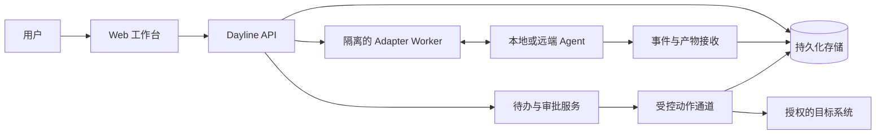

# Dayline 产品需求文档

[English](PRD.md)

- 版本：0.1
- 日期：2026-09-23
- 状态：产品与技术讨论基线，尚未实现的需求不代表现有能力。
- 目标：从一个人接入自己的 Agent 开始，逐步成为个人和小团队的日常 Agent 工作台。
- 名称：Dayline 为暂定产品名，发布前仍需检查名称、商标和域名。

## 1. 产品定位

> 让 Agent 替你推进工作，让你随时看懂进展、调整方向，并在重要动作发生前作决定。

Dayline 是连接人与不同 Agent 的工作监督平台。它把分散在聊天窗口、终端、脚本和服务中的 Agent 工作，整理为可追踪的任务、可检查的产物和明确的待办决策。

它不要求用户迁移到某个模型、重写所有 Agent，或先学会搭建工作流。用户可以继续使用自己的执行器，逐步接入 Dayline 支持的能力。

产品核心不是聊天、日报或审批按钮，而是完整的工作闭环：

```text
提出目标 -> 限定范围 -> Agent 执行 -> 人检查或介入
         -> 修改与复查 -> 批准必要动作 -> 确认结果 -> 留存工作记录
```

产品面向“使用和监督 Agent 的人”；Agent 开发框架、模型评测平台和企业治理系统是相邻产品，不是第一阶段要替代的对象。

## 2. 要解决的问题

当一个人同时使用多个 Agent 时，困难不再只是写出好提示词：

1. 不知道每个任务现在做到哪里，哪些正在等待自己。
2. 返回工作时必须翻读很长的对话，才能恢复上下文。
3. Agent 声称完成，但产物、依据和验证结果散落在不同位置。
4. 无法区分“执行结束”“结果合格”和“已经对外生效”。
5. 审批缺少具体对象和影响说明，用户容易机械地全部通过。
6. 反馈与新版本没有对应关系，难以确认修改是否真的落实。
7. 中断、重试或重复通知可能导致重复发布、重复执行或状态失真。

**产品假设：**把需要人的决定集中起来，同时保留任务上下文、产物版本和执行依据，可以降低监督成本，并减少误批与重复工作。

**证据边界：**现有 Genesia 中的 Dayline 和 OpenDesk 只是确定性的浏览器原型。它们不证明真实 Agent 接入、安全审批、市场需求或付费意愿。本 PRD 描述的是新的独立产品，不是对已有生产能力的总结。

## 3. 目标用户与初始切入点

| 优先级 | 用户 | 典型工作 | 首要收益 |
|---|---|---|---|
| 首批 | 经常使用 Agent 的个人开发者 | 资料整理、文档更新、代码变更、测试与发布准备 | 一个入口查看进展和需要自己决定的事 |
| 次批 | 学生、研究者、个人创作者 | 阅读整理、课程项目、研究笔记、汇报与协作消息 | 看懂来源、修订内容、确认再分享 |
| 后续 | 小型研发或项目团队 | 多人委派、共同验收、交接与对外沟通 | 明确谁负责、谁有权批准、交接后如何继续 |

第一阶段采用**单用户、可本地运行**的切入方式，但数据模型从第一天保留 `workspace_id`、所有者和执行身份。多人实时协作、组织级角色体系和 SaaS 多租户运营放到后续。

目标不是让所有用户都使用完全相同的任务，而是让不同工作都具有一致的监督入口。

## 4. 核心使用场景

### 4.1 日常返回工作台

你正在准备一个项目或课程汇报，已经把三件事交给不同 Agent。离开一段时间后，你打开 Dayline：

| 任务 | 状态 | 需要人的决定 |
|---|---|---|
| 整理参考资料 | 执行中 | 检查来源和范围，必要时调整方向 |
| 更新项目说明 | 待验收 | 查看修改前后差异，接受或退回修改 |
| 准备小组更新消息 | 待审批 | 核对内容与接收对象，发送、修改或暂存 |

三个任务可以独立推进。用户可以先处理风险最高或最紧急的事项，而不是被迫按步骤走完一条演示流程。

### 4.2 完整反馈循环

1. 用户打开一个需要注意的任务，看到目标、当前状态和等待原因。
2. 查看产物与来源，发现一项说法缺少依据。
3. 标记具体内容并提交修改要求。
4. Agent 继续工作，产出新的不可变版本。
5. 用户查看版本差异和修改说明，再决定是否接受。
6. 若还需要对外动作，单独核对动作内容和目标后批准。
7. 平台记录实际执行结果，而不是把点击批准当作完成。

### 4.3 从已有 Agent 渐进接入

用户先接入一个只会上报进度的本地脚本，再接入支持任务提交和产物返回的远端 Agent，最后为需要发布、写入等敏感动作的执行器配置受控审批。

不同接入深度必须在界面中明确显示，不能把“只能观察”包装成“已受平台约束”。

## 5. 产品原则

- **需要人才打断。**普通读取、计算和运行自动推进，不靠“运行下一步”按钮制造深度。
- **先说明决定，再给按钮。**用户需要看懂批准的对象、影响、范围和不可逆性。
- **状态与事实分离。**Agent 自述、工具结果、人工验收和外部回执分别展示。
- **来源可以追溯，不等于结论自动正确。**不制造没有依据的可信度百分比。
- **产物是工作对象。**对话用于协作，文档、补丁、报告和消息草稿有独立版本与状态。
- **默认最小权限。**读资料不等于能发消息，批准一次不等于以后全部允许。
- **诚实呈现恢复能力。**恢复本地旧版本不等于撤销已发送邮件、已合并代码或已发生付款。
- **保留不同 Agent 的能力差异。**不支持暂停、编辑或取消时不展示虚假的可用按钮。

## 6. 信息架构与两种视图

真实产品只有一个任务与事件模型，不维护功能逐渐分叉的 A/B 两套系统。

| 页面 | 核心内容 |
|---|---|
| 需要你处理 | 澄清问题、授权请求、待验收产物；按原因、风险、时间和任务筛选 |
| 工作列表 | 执行中、等待、待验收、已完成、已取消；搜索和任务切换 |
| 任务工作区 | 目标、范围、执行流、关联来源、产物版本、决定和实际结果 |
| Agent 与连接 | 执行器来源、连接健康、能力等级、授权范围、凭据引用 |
| 历史与设置 | 已处理决定、归档任务、数据保留和通知偏好 |

**当前 M0 V2 结构：**首页是固定的 Work 工作台。“需要你 / 执行中 / 全部”是同一工作列表的筛选，点选事项在右侧直接打开对应任务，不切换全局模块，也不经过 Open workspace 中转页。任务内提供 Result（产物与当前决定）、Workstream（执行过程）、Context（背景与范围）。

处理完成后在当前任务内显示结果，队列计数同步变化；已处理任务可暂留在“刚刚处理”区域，用户自主选下一项，不强制返回或弹出导航选择。已授权与执行回执分别表达。当前前端原型保存本地演示状态，不代表真实接入或审批执行边界。

此前两种研究方向作为同一产品中的互补能力保留，而不是互斥的 A/B 应用：

- **A / Workstream：**围绕连续对话和活动组织进展、问题、产物和审批。
- **B / Review Queue：**围绕任务、状态和待处理决定组织工作，进入详情后补足上下文。

两种视图必须使用相同任务、权限、产物和状态机；不能用功能缺失制造比较优势。真实产品可以结合两者，UXR 决定默认入口和信息密度，而不是预设赢家。

桌面优先，移动端至少支持检查结果、处理决定和查看历史。审批的关键参数不能在小屏幕中被省略。支持键盘导航、可见焦点、文字状态和可访问的错误反馈。

## 7. 功能范围

P0 为真实 MVP 必需；P1 为个人使用闭环稳定后的扩展；Later 不进入首版。

| 功能 | 优先级 | 要求与边界 |
|---|---|---|
| Agent 注册与连接 | P0 | 显式配置执行器、身份、能力和健康；至少支持本地 runner 与 HTTP adapter 两种接口形态 |
| 委派任务 | P0 | 设置目标、来源、完成条件和允许动作；仅向选定 Agent 发送必要材料 |
| 多任务总览 | P0 | 独立跟踪并发任务，区分运行、等待用户、失败和结果待验收 |
| 人工决策收件箱 | P0 | 区分澄清、授权、验收；每项都能回到任务上下文 |
| 执行过程 | P0 | 展示简明进展、工具动作和结果引用；保留完整记录但默认折叠技术细节 |
| 调整方向 | P0 | 对支持的 Agent 发送补充要求、暂停或取消；显示请求与实际生效状态 |
| 产物复核 | P0 | 安全预览文本、Markdown 和 diff；查看来源、版本和独立测试结果 |
| 修改与返工 | P0 | 接受整个版本、手工编辑为新版本、带具体反馈退回修改并复查 |
| 动作审批 | P0 | 展示实际动作、目标、参数、影响及权限范围；一次性批准或拒绝 |
| 交付 | P0 | 保存私人产物，或在批准后调用受控 adapter；显示目标端回执或未知结果 |
| 历史与恢复 | P0 | 重启恢复任务、决策和产物；归档与重开不删除或重放历史动作 |
| 失败与费用边界 | P0 | 超时、断连和运行预算；可重试性由动作语义决定；费用未知时显示未知 |
| 细粒度审阅 | P1 | 按段落或 diff hunk 部分接受、批注、跨版本反馈定位 |
| 通知与例行任务 | P1 | 浏览器或消息通知、可暂停的定时任务，避免重复打断 |
| 策略化授权 | P1 | 有限范围、限时授权与额度，不提供无边界的“全部信任”快捷方式 |
| 小团队协作 | P1 | 负责人、审阅者、审批者、转交和并发编辑冲突处理 |
| Agent 间交接 | P1 | 保留任务 lineage 与最小上下文；先复用现有执行器编排 |
| Agent 商店与自动编排 | Later | 不在 MVP 构建 marketplace、自治组织或通用 workflow builder |
| 企业与云平台 | Later | SSO、复杂 RBAC、完整多租户服务、计费和大规模集群 |

不在本期承诺：任意 Agent 零改造接入、任意 GUI 自动控制、完整 IDE、通用模型评测平台、自动证明事实正确、真实消息无痕撤回。

## 8. 核心对象

| 对象 | 含义 | 关键字段 |
|---|---|---|
| Workspace | 数据与权限边界 | id、owner、retention_policy |
| AgentConnection | 一个外部执行器的配置，不是模型名称 | adapter_type、endpoint_ref、credential_ref、capabilities、control_level |
| Task | 用户希望达成的工作目标 | goal、owner、completion_criteria、context_refs、status、parent_task_id |
| Run | 一次执行尝试 | task_id、agent_id、attempt、status、budget、heartbeat_at |
| Event | 执行或人工行为的可去重记录 | event_id、run_id、sequence、actor、type、occurred_at、received_at、payload |
| ArtifactRevision | 不可变产物版本 | artifact_id、revision_id、content_hash、media_type、source_refs、created_by |
| ReviewDecision | 对某版本的接受或修改要求 | revision_id、reviewer、decision、feedback、supersedes |
| ActionIntent | 即将产生影响的具体动作 | operation、target、arguments_hash、revision_id、risk、execution_state |
| Approval | 对 ActionIntent 的授权决定 | requester、approver、scope_hash、expires_at、status |
| ExecutionReceipt | 执行端确认或未知状态 | action_id、idempotency_key、external_ref、status、verification |

一个 Task 可以有多个 Run 和 ArtifactRevision。一次执行成功不意味着产物已被接受，也不意味着外部动作已经成功。

所有对象必须具备工作区归属；所有可执行决定必须有可验证的操作者身份。

## 9. 生命周期与恢复语义

### 9.1 Task

```text
draft -> active -> needs_review -> done -> archived
                  |               |
                  +-> active      +-> active (显式重开并创建新工作版本)
active / needs_review -> canceled -> archived
```

- 任务完成要求必要产物已接受，且必要交付动作有已知结果。
- “等待问题回答”和“等待授权”由 Run 与待办决定表达，不混作待验收。
- 归档是组织操作，不撤销产物、审批或已发生的外部动作。
- 返工创建新 Run/版本并关联原反馈；重开不会自动重复发布。

### 9.2 Run

主要状态：`queued`、`running`、`waiting_input`、`waiting_approval`、`pause_requested`、`paused`、`cancel_requested`、`succeeded`、`failed`、`canceled`、`interrupted`。

暂停和取消只有收到执行器确认后才算生效。断连显示最后确认状态与时间，不直接伪装为取消成功；恢复时先对账，不盲目启动第二次执行。

### 9.3 Approval 与执行

- Approval：`pending -> approved / rejected / expired / superseded`。
- 执行：`not_started -> executing -> succeeded / failed / outcome_unknown`。
- 修改待发内容、接收对象、动作参数或所依据的版本后，旧审批失效，产生新的请求。
- `approved` 只代表授权，不代表 `executing` 或 `succeeded`。
- 超时但无法判断目标端是否已执行时进入 `outcome_unknown`，先查询回执或人工核对，不能直接重复执行。

## 10. Agent 接入策略

### 10.1 能力分级

| 等级 | 能力 | 产品承诺 |
|---|---|---|
| Observe | 仅接收事件、日志或产物 | 可以查看，不承诺能暂停、取消或阻止执行 |
| Delegate | 提交任务、收进度和产物，可能支持反馈或取消 | 只开放 adapter 声明并经过验证的控制 |
| Controlled | 敏感动作先请求平台授权，再通过受控执行通道执行 | 只有被实际拦截的动作才展示“审批已强制执行” |

一个连接可以对读取支持 Delegate，对发布支持 Controlled；控制等级应落到能力/动作，不只给整个 Agent 一个笼统标签。

### 10.2 首批连接方式

1. **本地 runner adapter：**用户显式配置可执行程序与工作目录，通过结构化 JSONL/stdio 或官方 SDK 传递任务和事件。命令使用参数数组，不拼接 shell 字符串。普通日志属于不可信输出，不能直接解释成授权。
2. **HTTP adapter：**通过经过身份校验的提交、回调或轮询接口连接已有 Agent 服务；支持断线重连、事件去重、产物上传和明确的操作能力声明。
3. **现有 Agent SDK/CLI：**优先使用官方接口或 hook。没有阻塞工具执行的能力时降级为观察或委派，不靠读取终端文字假装拥有安全控制。

MCP 可用于向 Agent 提供受控工具和上下文，但它本身不等于任务生命周期、审批协议或完整 Agent 接入协议。不能仅因为一个 Agent 支持 MCP 就宣称已经可被 Dayline 完整管理。

首版不绑定某个供应商；具体第一个真实 Agent 应在开工前选择。现有 Genesia 用于后续 UX 研究，不作为 Dayline 的执行运行时。

### 10.3 最小协议草案

Adapter 至少声明 `submit_task`、`stream_events`、`get_status`、`publish_artifact`，以及可选的 `respond`、`pause`、`resume`、`cancel`、`request_action_approval`、`reconcile_action`。Observe 连接可只实现读取部分。

事件 envelope 示例；工作区和执行器归属由服务端根据认证身份校验，不能信任 payload 自报：

```json
{
  "schema_version": "0.1",
  "event_id": "evt_0042",
  "run_id": "run_0012",
  "sequence": 42,
  "type": "approval.requested",
  "occurred_at": "2026-09-23T09:30:00Z",
  "payload": {
    "action_id": "action_0007",
    "operation": "message.publish",
    "target": {"channel_id": "project-team"},
    "artifact_revision_id": "revision_0003"
  }
}
```

常用事件包括 `run.started`、`run.progress`、`input.requested`、`artifact.created`、`approval.requested`、`action.result`、`run.completed` 和 `run.failed`。动作参数和内容 hash 由平台在创建 ActionIntent 时规范化并绑定。

协议需要版本协商、唯一事件 ID、Run 内顺序、重放游标、确认和幂等处理。采用可恢复的至少一次传递，不宣称网络可以保证恰好一次执行。缺失事件时先补齐或标记不完整，不能用时间戳猜顺序。

## 11. 审批必须成为执行边界

“界面里有批准按钮”不足以构成安全能力。受控动作的执行路径必须是：

```text
Agent 提议动作
  -> 平台验证身份、权限与参数，保存不可变 ActionIntent
  -> 人审阅具体内容、目标和影响
  -> 保存一次性、限时、绑定版本和参数的 Approval
  -> 执行前再次检查权限、版本、有效期与并发状态
  -> 受控 runner / action gateway 执行
  -> 保存回执并更新工作状态
```

- 审批不能越过连接本来的权限，也不能授予操作者自身没有的权限。
- 默认“批准这一次”；更宽的策略授权单独配置、可撤销并有边界。
- 更换产物、收件人或参数必须重新审批，防止审批后偷偷换内容。
- 执行前持久化意图并使用原子状态转换、幂等键和 worker lease 防止重复消费。
- 外部系统没有幂等能力时，平台必须承认不确定性，提供核对流程。
- 若外部 Agent 持有独立凭据且可以绕过平台执行，Dayline 无法保证拦截；界面必须显示该限制。
- 用户同意运行一个 Agent，不等于同意它访问所有资料或执行所有外部动作。

## 12. 技术方向

以下是建议起点，不是不可改变的技术选型。



- 前端建议 React + TypeScript；任务队列、对话流和产物面板共享领域状态。
- 后端建议 Python + FastAPI/Pydantic，以便先接入自有 Python Agent；不把 UI 直接连接到每个供应商。
- 初期用模块化单体、SQLite 和本地 artifact 存储；任务调度和事件持久化从一开始具备崩溃恢复能力，后续再考虑 PostgreSQL、对象存储和分布式队列。
- 浏览器实时更新可先用 SSE，写操作走经过认证的 HTTP API；断线后从已确认游标恢复。
- runner 与 API 进程分离。独立进程和工作目录不等于安全沙箱；不可信代码执行需要容器或 OS 级隔离及资源限制。
- 原始事件和产物版本追加保存，UI 使用可重建的状态投影。修改或脱敏通过显式操作留痕，不原地改写决策历史。

## 13. 安全、隐私与部署

- 默认绑定 `127.0.0.1`。开放网络访问必须显式启用，并配套认证、HTTPS 和授权检查。
- 本地模式也要检查浏览器来源、防止 CSRF，并保护 runner/control API，不能把“本机”当作无认证信任边界。
- 连接和回调使用可撤销、可限定权限的身份；校验签名/认证、事件归属和重放，不接受匿名审批或任意任务 ID 注入。
- 凭据保存在 OS 凭据存储或外部 secret store，配置只保存引用；日志、UI、提示词、分享包中不出现密钥。
- 来源文档、Agent 输出和工具结果均为不可信内容。它们不能改变平台权限、审批范围或服务端策略。
- Markdown/HTML 预览必须消毒；初版不执行产物内脚本，不自动打开危险链接，不自动运行收到的代码。
- 文件下载、路径、回调目标和远端 URL 都要限制范围，防止路径穿越、跨工作区访问和 SSRF。
- 用户可配置保留期限、导出和删除。审计完整性与删除需求要通过明确的元数据/内容保留策略协调，不承诺永久保存所有正文。
- 分享界面显示最终接收方与范围；本地私人产物不会默认同步到第三方。
- 公开仓库只放许可明确的代码和合成 demo 数据，不迁移 Genesia 中来源或再分发权不明的 Persona、截图、原始运行或私有配置。

## 14. 质量指标与验收

### 14.1 关注的产品指标

- 用户能否准确找到当前需要自己处理的事项。
- 从返回任务到理解当前状态所需的时间，分开记录阅读时间与 Agent 等待时间。
- 用户能否说清某次批准的内容、对象、范围和后果。
- 反馈后返回的版本是否真正满足原修改要求。
- 无意对外动作、重复动作、过期批准执行和错误权限放行次数。
- 用户一周内是否愿意持续从 Dayline 管理真实工作，而不是只完成一次演示。

不要把审批次数少、点击次数少、Agent 自报成功率或用户全部通过当作单独的成功指标。早期目标先建立基线，不编造提升百分比。

### 14.2 真实 MVP 发布门槛

1. 至少接入两个不同接口形态的真实执行器；至少一个支持可验证的受控动作。
2. 三个任务可独立进行，切换、刷新和服务重启后不丢失已保存的工作与决定。
3. 完整通过“委派 -> 执行 -> 退回修改 -> 新版本 -> 复查接受 -> 必要审批 -> 交付回执”。
4. 澄清、动作审批、产物验收在界面和数据模型中可明确区分。
5. 未批准、已拒绝、已过期、已被新版本替代的动作都不能通过受控通道执行。
6. 双击批准、重复回调、乱序事件、worker 重启不会导致未经核对的重复外部执行。
7. 无法确认的外部结果显示未知；取消请求不会被提前显示为取消成功。
8. 每个来源、产物版本、审阅决定、动作授权与回执能相互追溯。
9. 不支持的 Agent 控制明确禁用；Observe 连接不被误标为受控连接。
10. 测试覆盖越权、内容注入、路径穿越、敏感信息泄漏，以及恶意产物预览。
11. 键盘与移动端可完成关键审查和批准，不遮挡动作对象与影响范围。
12. 使用测试目标或沙箱验证外部动作；demo 和真实执行始终有可见区别。

## 15. 交付路线

| 阶段 | 交付物 | 完成条件 |
|---|---|---|
| M0 产品与协议验证 | 三任务可点击体验、任务/审批/产物契约、adapter 能力表 | 真实目标用户看得懂任务与决定；确定首个接入执行器 |
| M1 真实纵向闭环 | 一个本地 runner、持久化任务与产物、人工返工、受控测试目标 | 同一个任务可以从真实执行走到人工审阅和实际测试回执 |
| M2 个人可用 MVP | 第二种 adapter、多任务收件箱、重启恢复、审批安全与失败处理 | 达到第 14 节门槛，并用于自己的日常工作 |
| M3 小范围试用 | 通知、细粒度反馈、有限团队角色与分享 | 根据真实使用决定扩展，不先建通用企业平台 |

第一条真实集成选择风险低、容易验收的工作，例如从选定本地材料生成项目更新，再由用户批准发送到测试频道。不要以真实付款、批量删除或自动合并主分支作为第一条集成。

## 16. 与原型和 Genesia 的关系

现有 Dayline A/B 可作为布局和交互参考，但属于一次性、确定性的前端原型，不应直接被视为生产架构。

新产品需要独立实现多任务领域模型、持久化、真实 adapter、权限与执行边界。旧 OpenDesk 仍可保留为更复杂的垂直场景研究，不需要迁入本工程。

Genesia 可以在后续比较 Workstream 与 Review Queue 的可理解性、监督体验和恢复路径；它不是 Dayline 的必要依赖，也不能用 synthetic Persona 结论替代真实用户验证。

UXR 给用户目标和背景，不提前泄露错误位置或正确选择。研究深度取决于真实决策、返工和恢复，不人为凑点击数；步数预算在实测完整旅程后设置，不沿用旧 comparison 的 23 步假设。

## 17. 开工前需要确定的事项

| 决策 | 当前建议 | 需要补充的信息 |
|---|---|---|
| 第一批 Agent | 先接一个自有本地 Agent，再接一个 HTTP 服务 | 实际框架、启动方式、接口和审批 hook |
| 第一个外部动作 | 向测试频道发送明确版本的消息 | 目标服务和可用沙箱 |
| 运行环境 | Windows 本地开发，结构上兼容 Linux | 是否需要容器、远端 runner 或移动端访问 |
| 模型关系 | 由已有 Agent 管理模型，Dayline 不要求统一 provider | 是否确实需要平台级模型配置 |
| 授权与角色 | 首版一个所有者、逐次批准 | 何时需要多人和审批转交 |
| 开源与部署 | 先自托管，选择明确许可证 | 代码许可、第三方资产许可和后续托管计划 |

以上为待确认的产品决策，不阻塞阅读和讨论；实现真实连接前必须核实，不能凭接口名字推定已有能力。

## 18. 市场参考

以下用于说明产品模式，不表示逐项实测、合作关系或允许复制品牌与资产。功能会变化，落地集成前应重新核对官方接口和条款。

- [Dust](https://dust.tt/) / [官方文档](https://docs.dust.tt/docs)：团队共享上下文、Agent 对话、工具授权与产物协作。
- [Lindy](https://www.lindy.ai/)：日常委派、例行工作和关键动作前的人类确认。
- [Relevance AI](https://relevanceai.com/)：结构化任务、Agent 运行可见性与人工审批。
- [Gumloop](https://www.gumloop.com/)：连接工具、Agent 工作与可共享产物。
- [Devin](https://devin.ai/)：开发者委派、结果审阅及通过反馈完成工作。

Dayline 的初始差异化假设是：**把已有 Agent 接起来，以人的注意力、明确决定和可验收的产物为中心组织工作**，而不是再提供一个 Agent 构建器。这个假设需要真实使用验证。